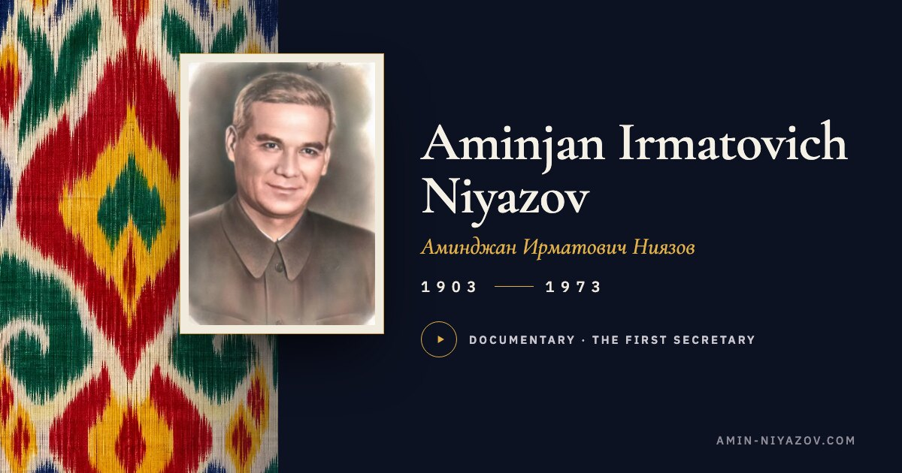

# Aminjan Niyazov Memorial

**🌐 Live: [www.amin-niyazov.com](https://www.amin-niyazov.com)**

A memorial website dedicated to **Aminjan Irmatovich Niyazov (1903–1973)**, the Soviet Uzbek statesman who rose from a sharecropper's son to become First Secretary of the Communist Party of Uzbekistan.



## About

Aminjan Niyazov's life spanned the entire arc of Soviet history. He managed wartime finances as People's Commissar during WWII, built the irrigation infrastructure that fed millions, mechanized cotton harvests, constructed schools and hospitals, and hosted world leaders including Jawaharlal Nehru and Indira Gandhi.

He was dismissed in 1955 by his former classmate Nikita Khrushchev, bore it without bitterness, and continued serving: he pioneered natural gas supply to Uzbek households and helped build the Tashkent–Kokand highway.

## Features

- 🎬 **Documentary film**: *The First Secretary* in English and Russian. The Russian site plays the Russian cut; subtitles are available in both.
- 📖 **Biography in chapters**: a sticky chapter thread on desktop, a chapter sheet on phones, a reading-progress line, and current-chapter context in the top bar.
- 🧭 **At a glance**: a fact file plus a "career ladder" chart of every office he held on a 1925–1960 axis.
- 🏗️ **What He Built**: six domains with custom icons.
- 📸 **Photo gallery**: seven archival photographs in justified rows with captions, plus an accessible viewer (keyboard, swipe, captions in all five languages).
- 🌍 **5 languages**: English, Russian, Uzbek, French and Spanish. A link can force a language with `?lang=ru`, `?lang=uz` and so on.
- 🌓 **Dark and light**: dark night-indigo first, with a mulberry-paper light theme. The site follows the system setting and remembers a manual choice, with no theme flash on load.
- ♿ **Accessible**: skip link, landmarks, focus styles, a single `h1`, alt text, named controls, reduced-motion support and a print stylesheet.
- 🔎 **SEO**: canonical URL, an absolute-URL 1200×630 OG card, and JSON-LD `Person` + `VideoObject`.

## Design: "Abr", the cloud thread

The 2026-11 redesign takes its identity from Margilan *abr* (ikat) silk. Niyazov was born at Ak-Tepe, near Margilan. The film's title card already pairs blurred ikat, a Cormorant serif and a gold rule, and the site now shares that identity.

- **Type:** Cormorant Garamond (display) · Literata (reading) · IBM Plex Sans (interface). All three cover Cyrillic and Uzbek ʻ.
- **Palette:** night indigo `#0D1222` · silk ivory `#ECE6DA` · Margilan saffron `#E2B04A`. The ikat colours madder, emerald and indigo appear only in silk details.
- **Higgsfield:** the design was explored as generated reference boards (`design/boards/`, GPT Image 2.5). Higgsfield also produced the ikat silk textiles, the mulberry-paper texture, the 12-glyph icon set and the ganch ornaments; the icons and ornaments were traced to SVG with potrace.
- **Real photographs only:** every image of a person is a real archival photograph, never generated or altered. The black pillarbox bars were trimmed as a pixel crop only.
- **Brief:** see `design/BRIEF.md`.

## Key Positions

| Period | Position |
|--------|----------|
| 1950–1955 | First Secretary, Communist Party of Uzbekistan |
| 1947–1950 | Chairman, Supreme Soviet of Uzbek SSR |
| 1946–1947 | Deputy Chairman, Council of Ministers |
| 1940–1946 | People's Commissar of Finance |
| 1934–1940 | Chief Engineer, Chirchik Electrochemical Combine |

## Structure

```
index.html            the whole site: markup, CSS and JS; translations live in const T (content) and const UI (interface)
assets/               ikat silk, paper texture, icons.svg sprite, seal ring and divider (SVG masks)
photos/               original archival photographs (unchanged)
photos/web/           trimmed, resized WebP copies used by the page
film/                 posters and subtitle tracks (films live in Vercel Blob)
favicon.svg, *.png, site.webmanifest, og-image.jpg
design/               brief and Higgsfield boards (not deployed; see .vercelignore)
```

To edit text, change the key in `const T` for each language. Every element with `data-i18n="key"` also carries the English text as its static default.

## Tech Stack

- Pure HTML/CSS/JavaScript, with no framework and no build step
- Hosted on [Vercel](https://vercel.com), with a custom domain via Vercel DNS
- Films in a public Vercel Blob store; Vercel Speed Insights

## Related memorials

- [Gulam Babodjanov](https://www.gulam-babodjanov.com): Rector of the Tashkent Agricultural Institute, Scientist of Silk (1907–1955)
- [Giyas Umarov](https://www.giyas-umarov.com): Founder of Heliotechnology, Academician (1921–1988)

## Deploy

Merging to `main` deploys to production through the Vercel Git integration, and every branch gets a preview deployment. A manual production deploy is also possible:

```bash
npx vercel --prod
```

## License

© 2024 Niyazov Family. All rights reserved.
